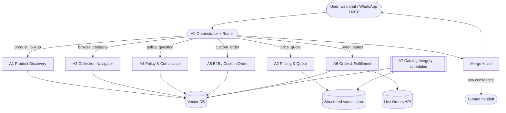

# PackItUp.com.pk — Multi-Agent Architecture

**Domain:** packitup.com.pk — Shopify storefront selling food-service & retail packaging in Pakistan (PKR).
**Corpus scale (crawled):** 187 products · 1,131 variants · 56 collections · 25 pages · 3 policies · 451 embedding chunks.

---

## 1. Why multiple agents

The crawled data splits into **four retrieval domains with different shapes and different correctness requirements**:

| Domain | Source of truth | Shape | Failure if wrong |
|---|---|---|---|
| Catalog & pricing | `products.json` / `chunks.jsonl` type=`product` | 187 records, 1,131 priced variants | Wrong price/stock → bad quote |
| Collections / navigation | `chunks.jsonl` type=`collection` | 56 category hubs | Wrong category → poor discovery |
| Policies | `chunks.jsonl` type=`policy` | 3 documents (shipping, refund, privacy) | Wrong policy → legal exposure |
| Business / B2B | type=`page` (`custom-orders`, `food-restaurant`, `eco-packaging`) | 7 content pages | Lost custom-order leads |

A single monolithic RAG agent blurs these: a policy question must **never** be answered by a product chunk, and a price must come from the structured field, not from prose. So we split by domain and put a router in front.

---

## 2. Agent roster

### A0 — Orchestrator / Router Agent
- **Role:** Classify the incoming intent, extract entities (product, size, qty, city), dispatch to one or more specialists, merge replies.
- **Data:** No corpus of its own — only the **routing manifest** (intent → agent → collection).
- **Tools:** `classify_intent()`, `entity_extractor()`, `vector_search(collection, query, k)`, `fan_out(agents[])`, `merge_answers()`.
- **Intents:** `product_lookup`, `price_quote`, `bulk_order`, `policy_question`, `custom_order`, `order_status`, `smalltalk`.
- **Rule:** A query touching two domains (e.g. "how much is 12oz boba cup delivered to Lahore?") fans out to **A1 + A2 + A4** and merges.

### A1 — Product Discovery Agent
- **Role:** Natural-language → product. "frosted U-bottom cups for boba", "kraft burger boxes".
- **Data:** `products` collection (244 chunks) + the 56 `collections` chunks for category framing.
- **Tools:** `vector_search("products")`, `metadata_filter(category, in_stock, price_max)`, `get_product(handle)`, `list_variants(handle)`, `image_lookup(handle)`.
- **Output contract:** title, handle, URL, price range, stock, sizes/pack options, top-3 images, `source_url`.
- **Guardrail:** If similarity < threshold → say not stocked; do **not** invent a SKU.

### A2 — Pricing & Quote Agent
- **Role:** Turn a size + quantity into a **pack-based price** and a bulk estimate.
- **Data:** `variants[]` inside each product chunk — this is the only agent allowed to state a number.
- **Tools:** `get_variants(handle)`, `select_variant(size, pack_qty)`, `multiply_qty()`, `format_pkr()`.
- **Guardrail:** Prices are **per pack**, not per piece. Quote must name the pack size (e.g. `12oz / 50 = PKR 2,900`). Never average across variants.

### A3 — Collection / Category Navigator Agent
- **Role:** "What do you have for a bakery?" → walks `collections` → returns the right hub + sub-hubs.
- **Data:** `collections` chunks + `collection_product_map.json` (collection → product handles).
- **Tools:** `vector_search("collections")`, `list_collection_products(handle)`, `browse_tree()`.
- **Why separate:** Category semantics ("baking packaging", "food & restaurant") do not map cleanly onto product titles; they need their own index.

### A4 — Policy & Compliance Agent
- **Role:** Shipping, returns/refunds, privacy — answered **only** from the policy corpus, with the clause quoted.
- **Data:** `policies` collection (5 chunks) — `shipping-policy`, `refund-policy`, `privacy-policy`.
- **Tools:** `vector_search("policies")`, `cite_clause(doc, section)`, `escalate_to_human()`.
- **Guardrail (hard):** Scope is locked to the `policies` collection. If the answer is absent (e.g. there is **no** published terms-of-service or payment policy on the live site), the agent must say so and escalate — never improvise a policy.

### A5 — Custom Order / B2B Sales Agent
- **Role:** Custom printing, branded packaging, restaurant/hotel supply, minimum quantities → qualify the lead.
- **Data:** `page` chunks for `custom-orders`, `food-restaurant`, `food-restaurant-1`, `eco-packaging`, `about-us`, plus the `*-custom` collections.
- **Tools:** `vector_search("pages")`, `collect_requirements(brand, qty, size, artwork)`, `create_lead()`, `handoff(human_sales)`.
- **Trigger:** Words like "custom", "printed", "our logo", "branded", "wholesale", "restaurant supply".

### A6 — Order & Fulfillment Support Agent
- **Role:** Post-purchase — order status, delivery timeline, returns, complaints.
- **Data:** Live order lookup (Shopify Admin/Orders API) + `shipping-policy` and `refund-policy` chunks for the rules.
- **Tools:** `get_order(order_id)`, `track_shipment()`, `vector_search("policies")`, `escalate_to_human()`.
- **Guardrail:** Never exposes another customer's data; policy questions are delegated to **A4** to keep one citation path.

### A7 — Catalog Integrity / Ops Agent (offline, scheduled)
- **Role:** Keep the vector DB honest — re-embed on product change, flag stale prices, detect orphans.
- **Data:** Full corpus + Shopify `updated_at` timestamps (present on every product record).
- **Tools:** `diff_products()`, `reembed(handle)`, `flag_missing_category()`, `detect_price_anomaly()`.
- **Real finding it must surface:** **73 of 187 products have an empty `product_type`**, and one product has a **PKR 0.00** price — both are data-quality defects the store should fix at source.

---

## 3. Retrieval flow

```
User turn
   │
   ▼
[A0 Orchestrator] ── classify_intent + extract_entities
   │
   ├── product_lookup ─────► [A1 Product Discovery] ─► vector_search("products")
   │                              │                          + metadata_filter
   │                              └─► handle(s)
   │
   ├── price_quote ────────► [A2 Pricing & Quote] ──► variants[] from structured field
   │
   ├── browse_category ────► [A3 Collection Navigator] ─► vector_search("collections")
   │
   ├── policy_question ────► [A4 Policy & Compliance] ──► vector_search("policies")
   │                                                      (collection locked)
   │
   ├── custom_order ───────► [A5 B2B Sales] ──► vector_search("pages") + create_lead
   │
   └── order_status ───────► [A6 Order Support] ──► live order API + policy chunks
                                                        │
                                    ┌───────────────────┘
                                    ▼
                       [A0] merge → answer with source_url citations
                                    │
                        low confidence / out-of-scope
                                    ▼
                             escalate_to_human()
```

**Fan-out example** — *"Price for 500 frosted 12oz boba cups with lids delivered to Karachi?"*
`A1` finds `u-shaped-pp-plastic-cups-with-pp-sip-lids` → `A2` reads its `12oz / 50 = PKR 2,900` variant and computes 10 packs = **PKR 29,000** → `A4` returns the shipping-policy clause for Karachi → `A0` merges into one answer with three citations.

---

## 4. Mermaid diagram



---

## 5. Vector DB schema

**Collection: `packitup_knowledge`** — single collection, partitioned by `type` metadata (simpler ops, one index to keep warm).

```jsonc
{
  "id": "product-u-shaped-pp-plastic-cups-with-pp-sip-lids-0",
  "vector": [/* 1536-d, e.g. text-embedding-3-small */],
  "text": "PRODUCT: U-Shaped PP Plastic Cups with PP Sip Lids\nCategory: Packaging ...",
  "metadata": {
    "source_url": "https://packitup.com.pk/products/u-shaped-pp-plastic-cups-with-pp-sip-lids",
    "type": "product",              // product | collection | page | policy
    "title": "U-Shaped PP Plastic Cups with PP Sip Lids",
    "category": "Packaging",
    "price_min_pkr": 1500.0,
    "price_max_pkr": 52500.0,
    "in_stock": true,
    "skus": [],
    "tags": ["boba packaging Pakistan", "..."],
    "images": ["https://cdn.shopify.com/..."],
    "product_id": 15874142797984,
    "chunk_index": 0
  }
}
```

**Recommended physical split for production** (mirrors the agent boundaries, lets each agent be locked to its own index):

| Index / namespace | Contents | Used by | Count |
|---|---|---|---|
| `products` | one doc per chunk of a product record | A1, A2 | 244 chunks |
| `collections` | collection hubs + member handles | A3 | 195 chunks |
| `pages` | about, custom-orders, faq, category landing pages | A5 | 7 chunks |
| `policies` | shipping, refund, privacy | A4, A6 | 5 chunks |

**Chunking:** ~1,800 characters with 250-character overlap, split on newline boundaries. Each product chunk is **prefixed with a structured header** (title / category / price / stock / SKU / URL) so the price and stock survive retrieval and the LLM never has to infer them from prose.

**Retrieval:** hybrid — BM25 keyword + dense vector, fused with Reciprocal Rank Fusion; then metadata pre-filter (`in_stock`, `price_max_pkr`, `category`) applied **before** ranking for price-constrained queries.

---

## 6. Orchestration notes

- **Citations are mandatory.** Every chunk carries `source_url`; the router appends it to the reply. A statement without a `source_url` is not allowed to ship.
- **Price authority is single-source.** Only A2 may emit a number, and only from `variants[]`. This kills the classic "LLM hallucinated the price" failure.
- **Policy collection is locked.** A4's retriever is hard-scoped to `type=policy`, so a product description can never be cited as a shipping rule.
- **Stateless specialists, stateful router.** Specialists are pure functions (query in, cited answer out); the router holds conversation state, so agents can be scaled and swapped independently.
- **Human handoff is a first-class tool**, not an error path — A4 (missing policy), A5 (custom quote), A6 (complaint) all escalate deliberately.
- **The site already speaks agent protocols:** `robots.txt` advertises `https://packitup.com.pk/api/ucp/mcp` (UCP/MCP endpoint), `agents.md`, and a `sitemap_agentic_discovery.xml`. A6 and A2 should call that MCP surface for live cart/order/price data instead of scraping, which keeps the storefront as the single source of truth.
